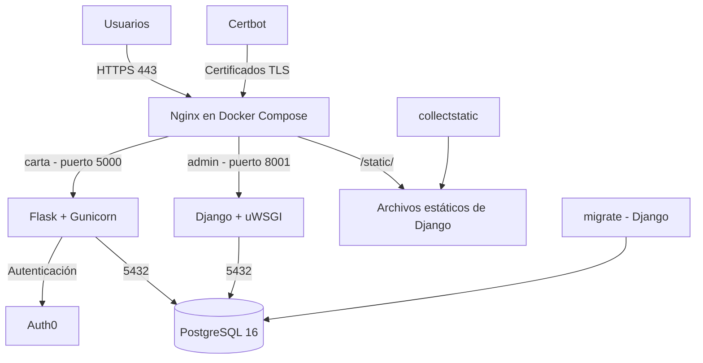

# La Carta — Sistema de Restaurantes

Aplicación para consultar restaurantes, realizar pedidos y gestionar su preparación. Utiliza Flask y Django sobre una misma base de datos PostgreSQL.

## 1. URLs públicas

- **Flask:** https://carta.jamu2-app.duckdns.org
- **Django Admin:** https://admin.jamu2-app.duckdns.org/admin/

Ambas aplicaciones utilizan HTTPS mediante Nginx y Let's Encrypt.

## 2. Arquitectura



Nginx publica los puertos **80 y 443**. Flask, Django y PostgreSQL se comunican por la red interna de Docker, sin exponer sus puertos directamente a internet. El servicio `migrate` aplica las migraciones antes del inicio de las aplicaciones.

## 3. Despliegue

Se requiere Linux, Git, Docker y Docker Compose.

**1. Clonar y configurar:**

```bash
git clone <URL_DEL_REPOSITORIO>
cd AplicacionesWeb
cp .env.example .env
chmod 600 .env
```

Completar `.env` con las credenciales de PostgreSQL, Flask, Django y Auth0.

**2. Preparar HTTPS:**

Configurar los DNS para apuntar al servidor. En una instalación nueva, iniciar Nginx temporalmente por HTTP y solicitar los certificados mediante Certbot:

```bash
docker compose -f docker-compose.prod.yml run --rm certbot certonly \
  --webroot -w /var/www/certbot \
  -d carta.jamu2-app.duckdns.org \
  -d admin.jamu2-app.duckdns.org \
  --email TU_CORREO --agree-tos --no-eff-email
```

Después, activar la configuración HTTPS de `nginx/nginx.prod.conf`.

**3. Levantar el proyecto:**

```bash
docker compose -f docker-compose.prod.yml up -d --build
docker compose -f docker-compose.prod.yml ps -a
```

Compose inicia PostgreSQL, ejecuta las migraciones de Django, recopila los archivos estáticos y levanta las aplicaciones. Para verificar las migraciones:

```bash
docker compose -f docker-compose.prod.yml logs migrate
```

**4 Crear superusuario de Django**

El superusuario de Django no se crea automáticamente al iniciar Docker Compose. Por lo tanto, después de levantar los servicios y aplicar las migraciones, es necesario crearlo manualmente:

docker compose -f docker-compose.prod.yml exec django python manage.py createsuperuser

El comando solicitará un nombre de usuario, correo electrónico y contraseña. Estos datos se guardan en PostgreSQL y permiten acceder al panel administrativo:

https://admin.jamu2-app.duckdns.org/admin/

Este procedimiento solo debe realizarse una vez, ya que el usuario permanece almacenado en el volumen persistente de PostgreSQL.

## 4. Decisiones de implementación

**1. Base de datos compartida.** Los modelos de Flask utilizan `__tablename__` para apuntar a las tablas `content.restaurantes`, `content.platos`, `content.pedidos` y `content.items_pedido`. Solo Django crea y modifica el esquema mediante migraciones, evitando conflictos entre ambos frameworks.

**2. Protección de pedidos ajenos.** En `app/routes.py`, `detalle_pedido()` busca el pedido por su ID y por el `sub` de Auth0. Devuelve `404` en lugar de `403` para no revelar si existe un pedido de otro cliente.

**3. Reglas de negocio.** En `app/routes.py`, `crear_pedido()` valida platos, cantidades y disponibilidad, calcula el total y guarda el pedido mediante una transacción. `cancelar_pedido()` permite cancelar únicamente pedidos pendientes y `avanzar_pedido()` controla las transiciones `pendiente → en_preparacion → listo → entregado`. Las restricciones `CHECK` están en `Django/restaurant/models.py`.

**4. Seguridad de secretos.** Las contraseñas, claves de Flask y Django y credenciales de Auth0 se guardan en `.env`, excluido de Git. En EC2, el archivo tiene permisos `600`, por lo que únicamente su propietario y los procesos privilegiados pueden leerlo directamente.

## 5. Limitaciones y posibles mejoras

- **Códigos HTTP:** cuando se envía un ID de plato inexistente al crear un pedido, la aplicación responde `400`, aunque la rúbrica solicita `404`.
- **Cantidades:** el formulario permite cantidad `0` para indicar que un plato no fue seleccionado; solo guarda ítems con cantidades entre 1 y 20.
- **Administración de Django:** al gestionar pedidos aparecen platos de distintos restaurantes, aunque existe una validación que impide asociarlos incorrectamente. También es necesario introducir manualmente el identificador del cliente. Se podría mejorar la interfaz mediante filtros y selección de clientes existentes.
- **Despliegue y mantenimiento:** la emisión inicial de certificados requiere una configuración HTTP temporal y la renovación automática de Let's Encrypt todavía no está configurada. Además, AWS Academy puede detener la instancia y cambiar su IP pública, lo que obliga a actualizar los registros DNS.
- **Infraestructura:** AWS Academy puede detener la instancia y cambiar su IP pública, lo que requiere actualizar DuckDNS.
- **DuckDNS en vez de freeDNS:** El plan para obtener los dominios de la aplicacion era usar freeDNS, pero debido a que el servicio se cayo un tiempo considerable, se opto por cambiar de plataforma para tener un entregable

- **Limpieza y mantenimiento del código:** el proyecto conserva algunas variables de entorno, configuraciones y dependencias provenientes de prácticas anteriores que podrían no utilizarse actualmente. Sería conveniente revisarlas y eliminar las innecesarias para simplificar el mantenimiento.

- **Pruebas automatizadas:** las pruebas utilizan SQLite y tokens de Auth0 simulados, por lo que no comprueban directamente la integración real con PostgreSQL ni con el servicio Auth0. Además, utilizan datos e identificadores previamente definidos y no cubren todos los casos posibles, como cantidades fuera de rango, platos de otros restaurantes o errores de conexión a la base de datos.